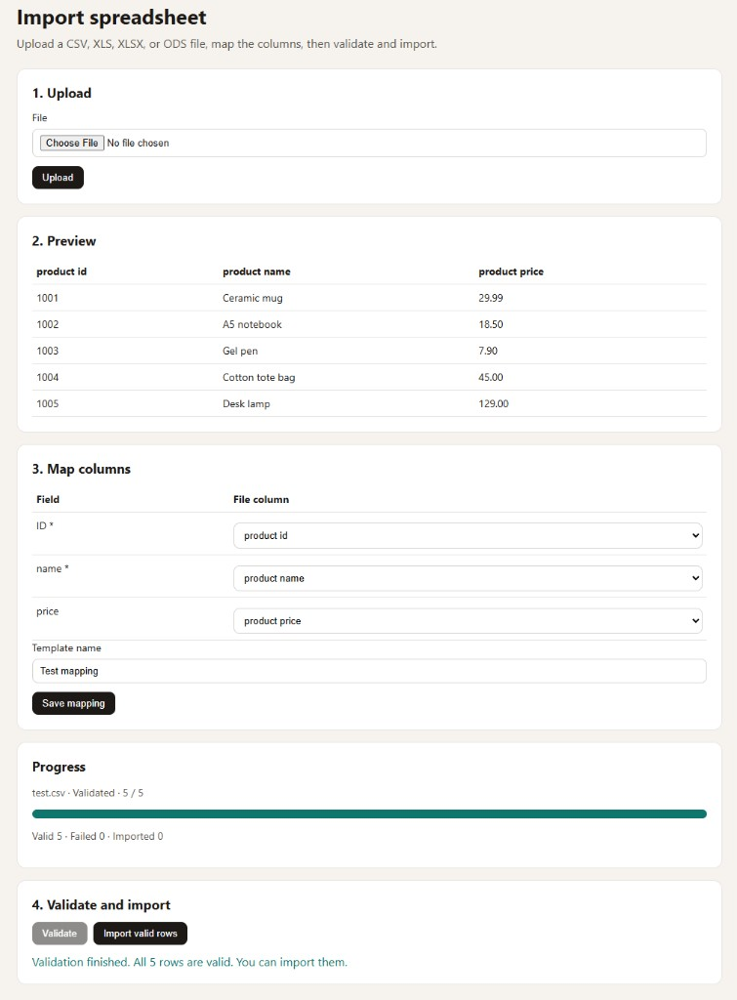

# Sheetflow

Sheetflow imports CSV, XLS, XLSX, and ODS files into Laravel models. The user uploads a file, checks a preview, maps columns, reviews row errors, and then imports the valid rows in the background. One JSON API feeds a Blade wizard and a Vue 3 component.

CSV, XLSX, and ODS are read with [OpenSpout](https://github.com/openspout/openspout), so those workbooks are streamed instead of loaded into memory. Legacy binary `.xls` is read with PhpSpreadsheet, which loads the whole workbook. A valid row is upserted with Eloquent. Replace `persist()` when the write needs to do something else.



## Requirements

- PHP 8.3+
- Laravel 13
- A queue connection with the `jobs` and `job_batches` tables
- A filesystem disk that exposes a local path (`local` by default). The readers open the stored file from that path.

A worker must be running for staging, validation, and import. With the `sync` driver those steps finish inside the HTTP request.

## Install

The package is published from GitHub. Add the repository, then require it:

```bash
composer config repositories.sheetflow vcs https://github.com/tom-padzik/sheetflow
composer require tpadzik/sheetflow
```

Publish the config if you want to change it, then migrate:

```bash
php artisan vendor:publish --tag=sheetflow-config
php artisan migrate
```

Migrations also load automatically from the package. Publish them with `--tag=sheetflow-migrations` when you want copies in the application.

Register each import under a key. The browser sends that key. It never sends a class name. Each key can point at a different model.

```php
use App\Imports\CustomerImport;
use App\Imports\ProductImport;
use Tpadzik\Sheetflow\Sheetflow;

Sheetflow::definition(key: 'products', definition: ProductImport::class);
Sheetflow::definition(key: 'customers', definition: CustomerImport::class);
```

Give every import its own address:

```php
Sheetflow::wizardRoute(uri: '/imports/products', definition: 'products', name: 'imports.products');
Sheetflow::wizardRoute(uri: '/imports/customers', definition: 'customers', name: 'imports.customers');
```

`wizardRoute()` returns the Laravel route, so you can add middleware there. Leave middleware empty when the route already sits inside a group such as `routes/web.php`. The same Blade page is used for every definition. The page's `data-definition` value selects the import.

The same idea works in Vue. One view, one component, a different `definition` prop on each route:

```php
Route::get('/imports/products', fn () => view('imports.products', ['definition' => 'products']));
Route::get('/imports/customers', fn () => view('imports.customers', ['definition' => 'customers']));
```

A map in `config/sheetflow.php` registers those Blade routes for you. A value is the definition key, or an array with `definition`, `name`, and `middleware`:

```php
'wizards' => [
    'imports/products' => 'products',
    'imports/customers' => [
        'definition' => 'customers',
        'name' => 'imports.customers',
        'middleware' => ['web', 'auth'],
    ],
],
```

The default group is still available. The JSON API lives under `/sheetflow/api`, and the Blade wizard for any registered key lives at `/sheetflow/{definition}`. Turn that wizard off with `register_wizard` set to `false` when only your own addresses should exist.

Mount another copy of the API and wizard under a different prefix, middleware, and route name. Set `register_routes` to `false` first when that copy should replace the default group rather than sit beside it.

```php
Sheetflow::routes(
    prefix: 'partner',
    middleware: ['web', 'auth:partner'],
    name: 'partner.sheetflow.',
    wizard: true,
);
```

That adds `/partner/products` and `/partner/customers`, plus `/partner/api/...`, using the same definition keys.

## Who may import

The package asks, on the way into the controller, whether this user may open this model. That covers the wizard page, the upload, and every later step on that import (mapping, sheet change, validation, import, cancel, failures, and templates). A refused check returns 403 before any file is stored and before a queued job starts. Stylesheet and script routes stay open, so a person who may import one model can still load the page.

How the permission is stored is the application's choice: a Gate, a role, a team, or anything else. Register one rule. It receives the current user, or `null` for a guest, and the definition key. Return `true` to allow that model.

A user who may import every model and a user who may import only one are both expressed here:

```php
use Illuminate\Contracts\Auth\Authenticatable;

Sheetflow::authorize(function (?Authenticatable $user, string $definition): bool {
    return null !== $user && (
        $user->can('sheetflow.import')
        || $user->can('sheetflow.import.'.$definition)
    );
});
```

`sheetflow.import` is the "every model" ability. `sheetflow.import.products` is the ability for the `products` key. Those names are examples. The package does not register them.

The same method accepts an invokable class. The class is resolved from the container on each check:

```php
Sheetflow::authorize(AuthorizeImports::class);

class AuthorizeImports
{
    public function __invoke(?Authenticatable $user, string $definition): bool
    {
        return null !== $user && $user->can('sheetflow.import.'.$definition);
    }
}
```

A single definition can add its own rule. Return `true` to allow, `false` to refuse, or `null` to leave the decision to the global rule:

```php
use Illuminate\Contracts\Auth\Authenticatable;

public function authorize(?Authenticatable $user): ?bool
{
    return null !== $user && $user->can('import-products');
}
```

The import opens when the global rule or the definition rule returns `true`. If the global rule returns `false` and the definition has no opinion (`null`), the request is refused. With neither rule in place, Sheetflow does not add a check: the `auth` middleware, when it is on the group, is enough.

This check is separate from ownership. A run still belongs to the user who created it, and someone else receives 403 even when they may open that model.

`SHEETFLOW_ALLOW_ALL=true` skips the rule so a local wizard can be clicked through. The package ignores that switch when `APP_ENV` is `production`, even if the variable is set there. `local` and `testing` honor it. Any other name, including `dev` or `staging`, is not production, so the switch still applies.

## Define an import

```php
use App\Models\Product;
use Tpadzik\Sheetflow\Field;
use Tpadzik\Sheetflow\ImportDefinition;

class ProductImport extends ImportDefinition
{
    public function model(): string
    {
        return Product::class;
    }

    public function fields(): array
    {
        return [
            Field::make(name: 'id')->label(label: 'ID')->rules(rules: ['required', 'string'])->matchOn()->guess(guesses: ['kod']),
            Field::make(name: 'name')->rules(rules: ['required', 'string']),
            Field::make(name: 'price')->rules(rules: ['numeric']),
        ];
    }
}
```

`Field::make()` starts a field whose name is the Eloquent attribute.

| Method | Effect |
| --- | --- |
| `rules()` | Laravel validation rules. A field without `required` is treated as `nullable`. |
| `guess()` | Extra header names used when the column map is first suggested. The field name and label are always candidates. |
| `matchOn()` | Include this attribute in the default `updateOrCreate()` lookup. |
| `label()` | Text shown in the wizard. The default replaces `_` in the field name with spaces. |
| `uniqueInFile()` | Reject every row where this field's non-empty value appears more than once in the file. |
| `onInvalid()` | What to do when the field's rules fail. `InvalidAction::SkipRow` rejects the row and continues. `InvalidAction::Null` stores an empty value when the field is not required. `InvalidAction::Stop` finishes the check and then refuses to import any row. Pass `allowed` when the person importing may choose among those actions in the column map. |

`ImportDefinition::authorize()` is optional and separate from the fields. Return `true` to allow this import, `false` to refuse it, or `null` to defer to `Sheetflow::authorize()`. See [Who may import](#who-may-import).

`ImportDefinition::saveTemplates()` is optional. Return `false` to hide saved maps for this import, `true` to keep them, or `null` to follow `sheetflow.save_templates`. The column dropdowns stay. Validate still sends the map shown on screen. The template name and **Save mapping** appear after validation finishes with no failed rows and the map still matches that check. When a later file has the same headers, choose a saved map and press **Load mapping** to fill the column dropdowns. `PUT /sheetflow/api/runs/{run}/mapping` with `save_template` returns 403 while the switch is off, and 409 until that validation has passed.

`validateRow()` is optional. It runs after the field rules, during validation and again before each row is written. Return field names mapped to message lists. An empty array accepts the row. Both sets of messages are kept.

```php
use Tpadzik\Sheetflow\MappedRow;

public function validateRow(MappedRow $row): array
{
    $errors = [];
    $email = $row->value(field: 'email');

    if (is_string($email) && '' !== $email && false === filter_var($email, FILTER_VALIDATE_EMAIL)) {
        $errors['email'][] = 'Enter a valid email address.';
    }

    $id = $row->value(field: 'id');

    if (is_string($id) && '' !== $id && Product::query()->where('id', $id)->exists()) {
        $errors['id'][] = 'This ID already exists.';
    }

    return $errors;
}
```

`value()` reads the mapped cell. `occurrences()` counts that same non-empty value across the file, including the current row. A repeated value can also be declared with `uniqueInFile()` on the field. A single cell can use a Laravel rule such as `email` or `unique:products,id`.

`validateFile()` is optional. It runs once before the per-row rules. Return row numbers mapped to field messages. An empty array accepts every row.

```php
use Tpadzik\Sheetflow\MappedFile;

public function validateFile(MappedFile $file): array
{
    $totals = [];

    foreach ($file->values(fields: ['id', 'FOO']) as $entry) {
        $id = (string) ($entry['id'] ?? '');
        $totals[$id] = ($totals[$id] ?? 0) + (float) ($entry['FOO'] ?? 0);
    }

    $errors = [];

    foreach ($file->rows() as $row) {
        $id = (string) $row->value(field: 'id');

        if (($totals[$id] ?? 0) > 200) {
            $errors[$row->rowNumber]['FOO'][] = 'The sum for this ID is over 200.';
        }
    }

    return $errors;
}
```

`rows()` lists every mapped row. `values()` returns the named fields together with the row number. `column(field: 'FOO')` returns `row` and `value` for that one field. Each row still has `rowNumber`, `attributes()`, and `value()`.

```php
use Tpadzik\Sheetflow\Enums\InvalidAction;

Field::make(name: 'id')->rules(rules: ['required', 'string'])->uniqueInFile(),
Field::make(name: 'price')->rules(rules: ['numeric'])->onInvalid(action: InvalidAction::Null),
Field::make(name: 'email')->rules(rules: ['email'])->onInvalid(
    action: InvalidAction::SkipRow,
    allowed: [InvalidAction::SkipRow, InvalidAction::Null],
),
```

When more than one action is allowed, the column map shows an **On error** choice. That choice is stored with the run and with a saved map. One allowed action is applied on its own. `Null` is ignored on a required field. A value repeated in the file still rejects the row when that field uses `Null` for ordinary rule failures. `Stop` leaves every row unimported and the wizard names the row that stopped the import.

`handle()` is final. For every valid row it calls `beforePersist()`, then `persist()`, then `afterPersist()`. Validation always runs before `handle()`.

The default `persist()` calls `updateOrCreate()` on the `matchOn()` attributes. With no `matchOn()` fields, or when those values are absent from the row, it calls `create()`.

Replace `persist()` to take over the write. The hooks still run.

```php
use Tpadzik\Sheetflow\MappedRow;

protected function persist(MappedRow $row): void
{
    $attributes = $row->attributes();

    Product::query()->updateOrCreate(
        ['id' => $attributes['id']],
        $attributes,
    );
}
```

`MappedRow` exposes `rowNumber` (the spreadsheet row, with the header as row 1), `raw` (header => cell), and `attributes()` (field => value for mapped columns).

## What a run does

1. **Upload.** The file is stored on the private disk. The response includes headers, sheet names, and about the first 20 data rows. Accepted extensions are `csv`, `txt`, `xls`, `xlsx`, and `ods`. CSV and TXT delimiters are detected from the first line (comma, semicolon, or tab). You can pass `delimiter` as one character. Encoding is UTF-8, and a leading BOM is skipped. The first sheet is used until the user picks another. `.xls` is loaded in full by PhpSpreadsheet; the other formats stay streamed.
2. **Staging.** One queued job reads the file once and stores raw rows in `sheetflow_rows`. Later steps do not re-read the workbook.
3. **Mapping.** The suggested map matches headers to field names, labels, and `guess()` values. Saving a template stores that map plus a signature of the header row. The next file with the same headers lists that map, and **Load mapping** copies it into the column dropdowns. The user still sees the map before continuing.
4. **Validation.** A queued batch checks every staged row and does not write models. Failures go to `sheetflow_failures` with the row number, raw values, and messages.
5. **Import.** Only valid rows are written, in chunks of 100, through a job batch. Each row is validated again immediately before `persist()`, because the database may have changed. A thrown exception on one row is stored as a failure and the chunk continues.
6. **Cancel.** Cancelling sets the run to `cancelled` and cancels the batch. The current chunk finishes, then the job stops. A cell is not rolled back mid-write.

Run statuses: `uploaded`, `staging`, `staged`, `validating`, `validated`, `importing`, `completed`, `failed`, `cancelled`.

Row statuses: `pending`, `valid`, `invalid`, `imported`.

Changing the sheet re-reads that sheet and replaces the staged rows. Changing the map after validation returns the rows to `pending` and deletes the failures, so validation has to run again.

The run belongs to the authenticated user who created it. A guest run is visible only while the request is also a guest. Anyone else receives 403. Opening the model is a separate check, described in [Who may import](#who-may-import).

## HTTP API

Routes use the `sheetflow.middleware` group. The default is `web` and `auth`. Send `Accept: application/json` and the CSRF header when the `web` group is in use.

| Method | Path | Purpose |
| --- | --- | --- |
| `GET` | `/sheetflow/{definition}` | Blade wizard for any registered key, when `register_wizard` is true |
| `GET` | paths in `wizards` or `wizardRoute()` | Blade wizard for one definition |
| `POST` | `/sheetflow/api/{definition}/uploads` | Store a file and start staging |
| `GET` | `/sheetflow/api/{definition}/templates` | List templates, optionally filtered by `header_signature` |
| `GET` | `/sheetflow/api/runs/{run}` | Run payload, including progress |
| `PUT` | `/sheetflow/api/runs/{run}/mapping` | Save the column map and, optionally, a template |
| `PUT` | `/sheetflow/api/runs/{run}/sheet` | Choose a sheet and stage it again |
| `POST` | `/sheetflow/api/runs/{run}/validation` | Queue validation. An optional `column_map` is saved first, so the wizard can validate the mapping shown on screen. |
| `POST` | `/sheetflow/api/runs/{run}/import` | Queue the import of valid rows |
| `POST` | `/sheetflow/api/runs/{run}/cancel` | Cancel staging, validation, or import |
| `GET` | `/sheetflow/api/runs/{run}/failures` | Paginate row errors, 20 per page |
| `GET` | `/sheetflow/api/translations` | Wizard strings for the current application locale |

Upload is multipart form data:

| Field | Rules |
| --- | --- |
| `file` | Required. Extensions `csv`, `txt`, `xls`, `xlsx`, `ods`. Max size from `sheetflow.max_kilobytes` (20480 by default). |
| `sheet` | Optional sheet name. |
| `delimiter` | Optional single character. |

The upload response is `201` and the run payload. Mapping body:

```json
{
    "column_map": {"id": "kod", "name": "Name", "price": null},
    "save_template": true,
    "template_name": "Shop export"
}
```

A `null` or empty header skips that field. Sheet body: `{"sheet": "Prices"}`.

The run payload includes `id`, `definition`, `status`, `filename`, `format`, `delimiter`, `sheet`, `headers`, `sheet_names`, `preview_rows`, `column_map`, `invalid_actions`, `stopped_row`, `fields` (`name`, `label`, `required`, `unique_in_file`, `invalid_action`, `allowed_invalid_actions`), `save_templates`, `templates` (`id`, `name`, `column_map`, `invalid_actions`), `total_rows`, `processed_rows`, `valid_rows`, `failed_rows`, `imported_rows`, and `percent`. `save_templates` is false when named maps are hidden, and `templates` is then empty. `stopped_row` is set when a field's error action stops the import.

Failures look like this:

```json
{
    "data": [
        {
            "row_number": 3,
            "values": {"id": "B-2", "name": null, "price": "nope"},
            "errors": {"name": ["The name field is required."]}
        }
    ],
    "current_page": 1,
    "last_page": 1,
    "total": 1
}
```

An unknown definition returns 404. A definition the current user may not open returns 403, on the wizard and on the API. The wizard assets (`/sheetflow/assets/wizard.js` and `wizard.css`) stay available.

## Blade wizard

The package route renders a full page and polls the run while its status is `staging`, `validating`, or `importing`. The page does not need Vite or Tailwind. Its stylesheet and script are package routes. The progress card sits directly above the validate and import buttons.

When validation finishes, the page states how many rows are valid and how many failed. If every row is valid, it also says they can be imported. Validate sends the column map currently shown in the form, so the check uses that map rather than the last one saved with **Save mapping**. When the import finishes, the same place under the buttons states how many rows were imported. If some rows failed, it includes that count too.

## Vue 3

`SheetflowWizard` is a single-file component. The host application compiles it. Point Vite at the package sources:

```js
import { fileURLToPath, URL } from 'node:url';
import vue from '@vitejs/plugin-vue';

export default defineConfig({
    plugins: [vue()],
    resolve: {
        alias: {
            '@sheetflow': fileURLToPath(new URL('./vendor/tpadzik/sheetflow/resources/js', import.meta.url)),
        },
    },
});
```

```js
import { createApp } from 'vue';
import { SheetflowWizard } from '@sheetflow';

const root = document.getElementById('sheetflow-vue');

createApp(SheetflowWizard, {
    definition: root.dataset.definition,
    apiBase: root.dataset.api,
}).mount(root);
```

`definition` is the registered key. `apiBase` is the API prefix, for example `/sheetflow/api`. The page needs `<meta name="csrf-token" content="{{ csrf_token() }}">` when requests go through the `web` middleware.

After you publish the UI, point the alias at `resources/vendor/sheetflow/js` instead of the package, so Vite compiles your copy.

## Customize the interface

Export the wizard into the application:

```bash
php artisan vendor:publish --tag=sheetflow-ui
```

That copies:

| Package file | Application copy |
| --- | --- |
| Blade page | `resources/views/vendor/sheetflow/wizard.blade.php` |
| Stylesheet | `resources/vendor/sheetflow/css/wizard.css` |
| Blade script | `resources/vendor/sheetflow/js/wizard.js` |
| Vue entry | `resources/vendor/sheetflow/js/index.js` |
| Vue component | `resources/vendor/sheetflow/js/components/SheetflowWizard.vue` |

Laravel prefers the published Blade view. The stylesheet and script routes serve the published files when those files exist, so the default page picks up CSS and script edits without a view change. The steps, mapping table, and error list are built in `wizard.js`. The Blade page is the frame around that script: title, CSRF token, and asset tags.

The Vue component imports `wizard.css` by a relative path. Keep the published `css` and `js` directories as siblings, or update that import.

Publishing again with `--force` replaces the copies, including local edits.

## Configuration

`config/sheetflow.php`:

| Key | Default | Purpose |
| --- | --- | --- |
| `prefix` | `sheetflow` (`SHEETFLOW_PREFIX`) | URL prefix of the default group |
| `middleware` | `['web', 'auth']` | Middleware for the default group and for `wizards` entries that do not set their own |
| `allow_all` | `false` (`SHEETFLOW_ALLOW_ALL`) | Skip the import rule outside production. Ignored when `APP_ENV` is `production` |
| `save_templates` | `true` (`SHEETFLOW_SAVE_TEMPLATES`) | Show saved maps. The template name and save button appear after validation finishes with no failed rows. A definition's `saveTemplates()` overrides this |
| `register_routes` | `true` | Register the default group. Set `false` and call `Sheetflow::routes()` yourself |
| `register_wizard` | `true` | Register `GET {prefix}/{definition}` inside that group |
| `wizards` | `[]` | Extra Blade URIs keyed to definition keys |
| `disk` | `local` (`SHEETFLOW_DISK`) | Private disk used to store uploads |
| `directory` | `sheetflow` | Directory on that disk |
| `preview_rows` | `20` | Data rows returned with the upload |
| `chunk_size` | `100` | Rows per validation or import job |
| `stage_batch_size` | `500` | Rows inserted per staging batch |
| `max_rows` | `100000` | Staging fails and deletes the rows when the file is longer |
| `max_kilobytes` | `20480` | Upload size limit |
| `queue` | `null` (`SHEETFLOW_QUEUE`) | Queue name. Empty uses the connection default |
| `connection` | `null` (`SHEETFLOW_QUEUE_CONNECTION`) | Queue connection. Empty uses the application default |

## Tables

| Table | Role |
| --- | --- |
| `sheetflow_runs` | File, map, counters, owner, batch id, status |
| `sheetflow_rows` | One raw staged row |
| `sheetflow_failures` | Row number, raw values, validation or persist errors |
| `sheetflow_mapping_templates` | Saved map for a definition, user, and header signature |

## Tests

Package tests use PHPUnit and Orchestra Testbench. From a checkout of this repository:

```bash
composer install
vendor/bin/phpunit
```

## Languages

The wizard follows `app()->getLocale()`. English, German, Spanish, and Polish ship with the package (`lang/{en,de,es,pl}/messages.php`). Other locales fall back to English until you add a file.

Publish the files when you want to change a sentence:

```bash
php artisan vendor:publish --tag=sheetflow-translations
```

Overrides live in `lang/vendor/sheetflow/{locale}/messages.php`. The Blade page puts the whole group on `data-messages`. The Vue component accepts a `messages` object; when that prop is omitted it loads `GET /sheetflow/api/translations`. Status values in the JSON API stay the English enum (`staged`, `validating`). Only the labels change. Laravel's own validation lines, such as "The name field is required.", still come from the framework locale files.

## Not in this version

Eloquent relationship linking, editing a cell in the browser, Inertia, Filament, and export.
